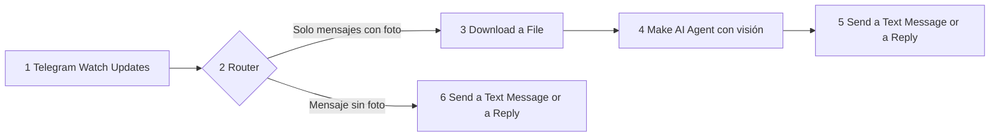
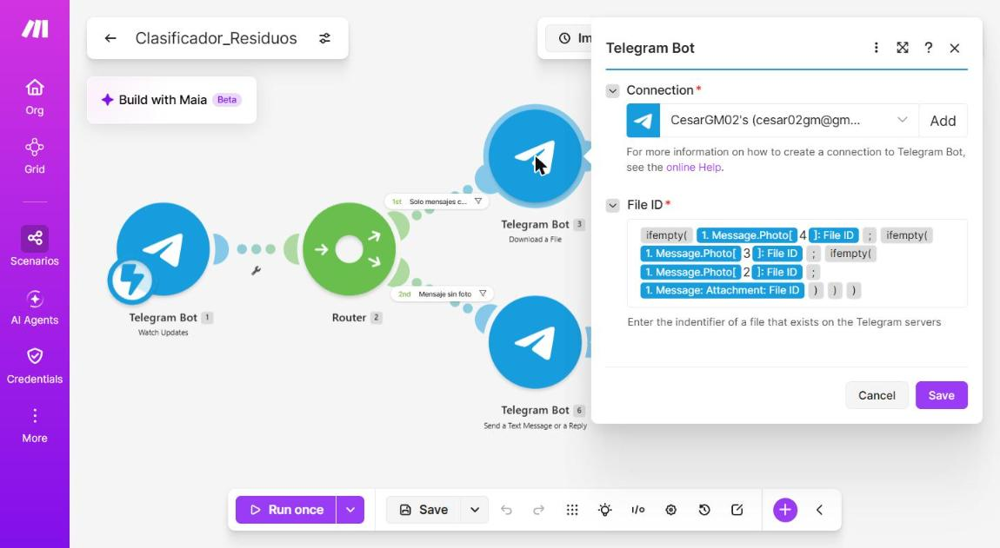
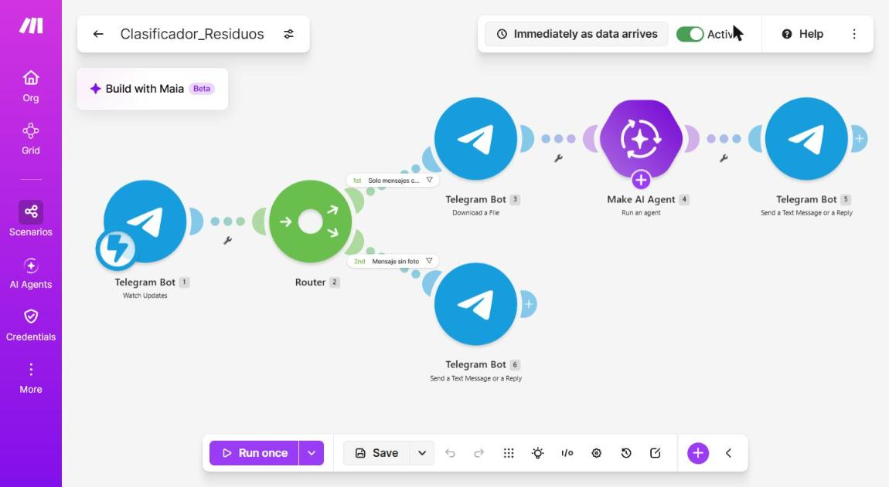
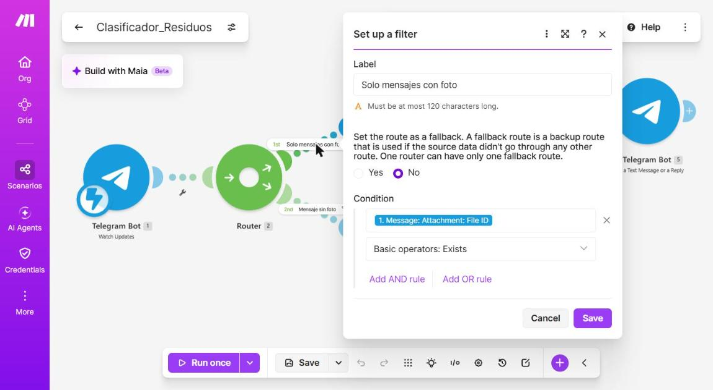
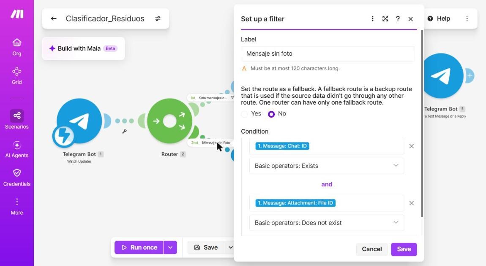
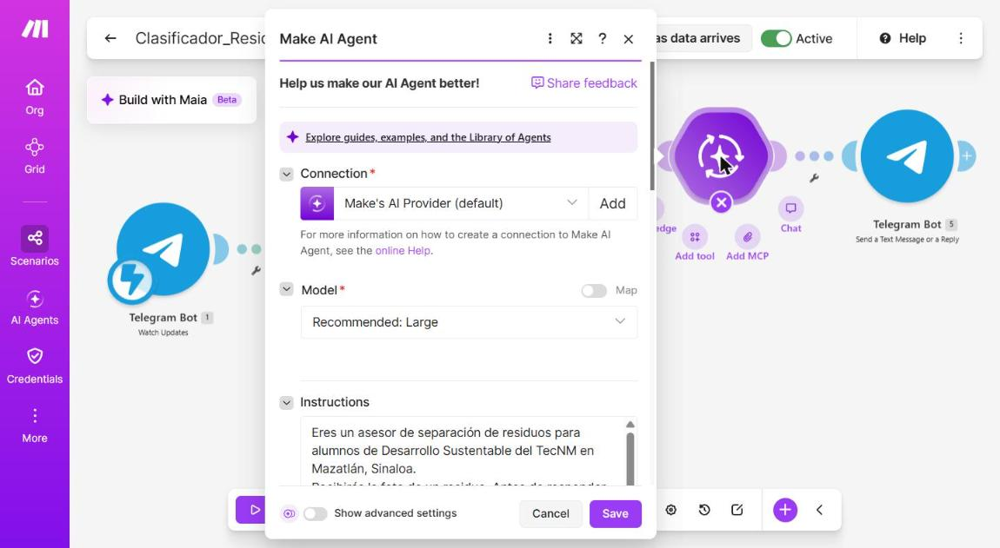
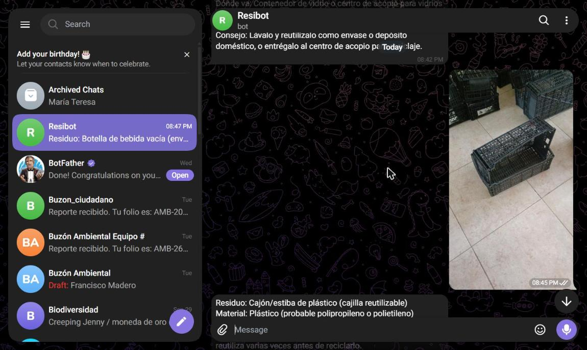
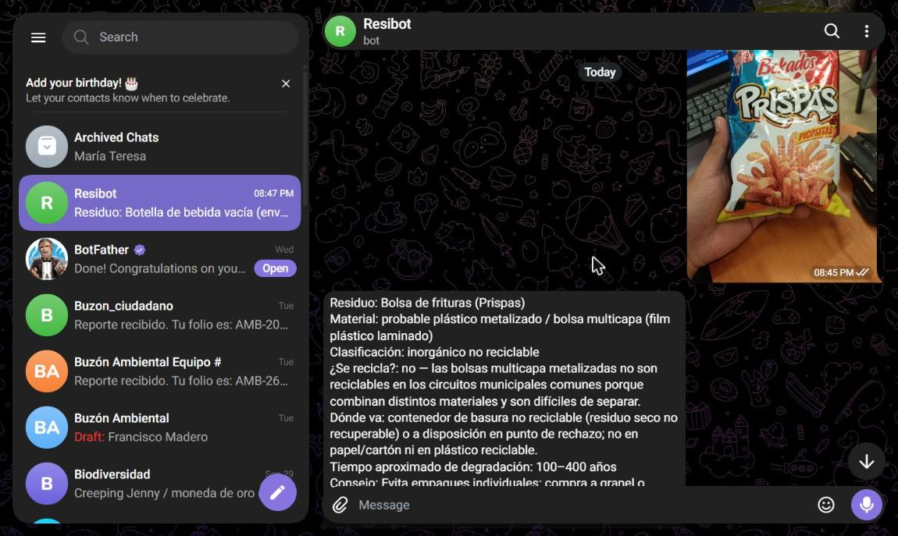
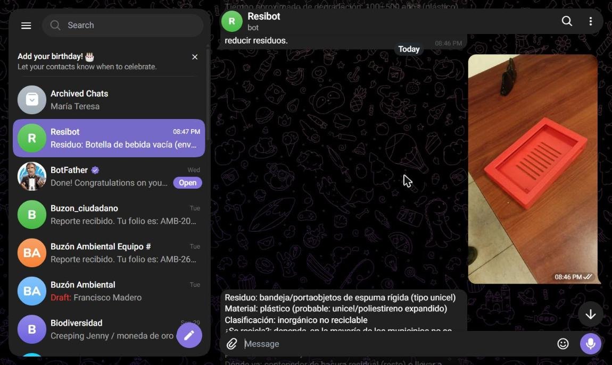
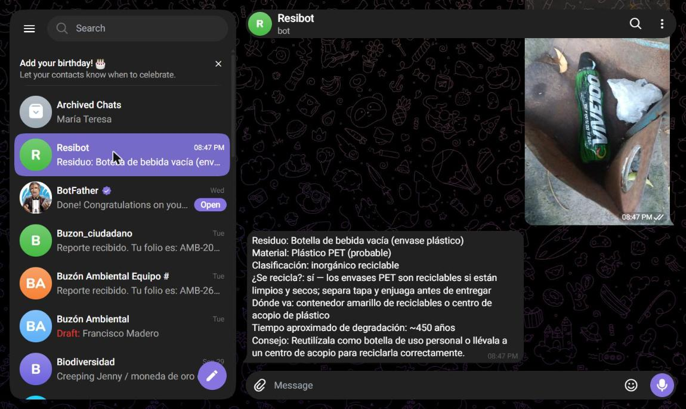

# Práctica 3.3 – Clasificador de residuos por foto

Reporte técnico de la práctica **3.3 Impacto de actividades humanas sobre la naturaleza**, de la materia Desarrollo Sustentable (ACD-0908).

| Campo | Detalle |
|---|---|
| Alumno | Cesar Jesus Gamez Mendoza |
| Carrera | Ingeniería en Sistemas Computacionales, Tecnológico Nacional de México, Campus Mazatlán |
| Unidad y tema | 3. Escenario socio-cultural, 3.3 Impacto de actividades humanas sobre la naturaleza |
| Práctica | 3.3-P4 Clasificador de residuos por foto (trabajo individual) |
| Herramientas | Telegram (BotFather), Make (Telegram Bot y Make AI Agent con visión) |
| Fecha de las pruebas | 29 de octubre de 2026 |

## Contenido del repositorio

```text
.
├── README.md                  Reporte técnico (este archivo)
├── codigo/
│   └── blueprint.json         Escenario de Make exportado
├── imagenes/                  Capturas del escenario, de los filtros y de las pruebas
├── video/
│   └── enlace.txt             Enlace al video en YouTube con la prueba en vivo
└── resultados/
    └── Resultados.pdf         Documento con lo aprendido en la práctica
```

## Objetivo

Identificar el impacto de los residuos que se generan en la vida diaria, construir sin programar un clasificador de residuos con inteligencia artificial y evaluar su precisión comparándola con fuentes oficiales.

## Cómo funciona

El usuario le manda al bot de Telegram la foto de un residuo. Make recibe la foto, la descarga, se la entrega a un agente de IA con visión y el agente responde qué es el residuo, de qué material está hecho, cómo se clasifica, si se recicla, a dónde va y cuánto tarda en degradarse. Si el mensaje no trae foto, el bot responde con instrucciones de uso.



### Módulos del escenario `Clasificador_Residuos`

| N.º | Módulo | Función |
|---|---|---|
| 1 | Telegram Bot, Watch Updates | Recibe cada mensaje que llega al bot mediante un webhook. |
| 2 | Router | Separa el camino de las fotos del camino de los mensajes sin foto. |
| 3 | Telegram Bot, Download a File | Descarga la foto usando el File ID de mayor calidad. |
| 4 | Make AI Agent (Run an agent) | Analiza la imagen con las instrucciones del asesor de residuos, usando la conexión Make's AI Provider (sin API key). |
| 5 | Telegram Bot, Send a Text Message or a Reply | Responde al usuario con el texto del agente. |
| 6 | Telegram Bot, Send a Text Message or a Reply | Responde las instrucciones de uso cuando el mensaje no trae foto. |

### Filtros del Router

| Ruta | Nombre del filtro | Condición |
|---|---|---|
| 1 | Solo mensajes con foto | Message: Attachment: File ID existe |
| 2 | Mensaje sin foto | Message: Chat: ID existe y Message: Attachment: File ID no existe |

### Instrucciones del agente

```text
Eres un asesor de separación de residuos para alumnos de Desarrollo Sustentable del TecNM en Mazatlán, Sinaloa.
Recibirás la foto de un residuo. Antes de responder, observa con cuidado: identifica el objeto principal que está en primer plano y fíjate en su forma, transparencia, brillo, textura, tapa, etiqueta o logotipo. No te guies por el fondo ni por objetos secundarios. Si dudas entre dos materiales, elige el más probable según lo que se ve y anótalo en la línea del material con la palabra "probable".
Responde en texto plano (sin asteriscos, sin markdown), en español, con este formato:

Residuo: [qué es]
Material: [material principal]
Clasificación: [orgánico / inorgánico reciclable / inorgánico no reciclable / manejo especial o peligroso]
¿Se recicla?: [sí / no / depende, con una línea de explicación]
Dónde va: [contenedor o lugar de acopio]
Tiempo aproximado de degradación: [tiempo]
Consejo: [1 línea para reducir o reutilizar este residuo]

Si la imagen no muestra un residuo o no se distingue, responde: "No pude identificar el residuo, envía otra foto más clara."
Si es un residuo peligroso (pilas, medicamentos, aceite, químicos), indícalo y recomienda no tirarlo a la basura común.
```

### Problema encontrado y cómo se resolvió

En las primeras pruebas la IA confundía los materiales y respondía cosas que no tenían relación con el objeto. Al revisar el historial de ejecuciones de Make se vio que el módulo Download a File descargaba la **miniatura** de la foto: el campo `Message: Attachment: File ID` apunta a la versión más pequeña (51 × 90 píxeles y 1 KB), mientras que Telegram también manda versiones de 720 × 1280 píxeles (127 KB). Con una imagen tan borrosa el agente adivinaba. La solución fue mapear el File ID de la versión más grande de la lista `Message: Photo`, con `ifempty()` para usar la siguiente más grande si no existiera. Después del cambio los datos transferidos por foto pasaron de unos 6 KB a entre 88 KB y 359 KB y las respuestas empezaron a coincidir con lo que se veía en la foto.



### Cómo reproducirlo

1. En Telegram, abrir `@BotFather`, enviar `/newbot` y crear el bot Clasificador Residuos.
2. En Make, crear una conexión de Telegram con el token del bot.
3. Importar `codigo/blueprint.json` en un escenario nuevo (menú de los tres puntos, Import Blueprint) y volver a elegir la conexión de Telegram, el webhook y la conexión Make's AI Provider.
4. Activar el escenario y enviar la foto de un residuo al bot.

### Seguridad

- El token del bot no está en este repositorio: se guardó únicamente dentro de la conexión de Make.
- El blueprint solo contiene identificadores internos de Make; no incluye contraseñas ni claves.
- Las capturas no muestran el token ni las pantallas de BotFather.

## Imágenes del escenario



Escenario completo, de izquierda a derecha: Watch Updates, Router, Download a File, Make AI Agent y respuesta. Debajo del Router, la ruta de los mensajes sin foto. Las etiquetas de los filtros se ven sobre cada ruta.



Filtro “Solo mensajes con foto”: el File ID del adjunto existe.



Filtro “Mensaje sin foto”: existe el Chat ID y el File ID no existe.



Configuración del Make AI Agent con la conexión Make's AI Provider y las instrucciones del asesor de residuos.

## Video

El video con la prueba en vivo está en YouTube: [https://youtu.be/8wRCzbViQjI](https://youtu.be/8wRCzbViQjI) (el mismo enlace está en `video/enlace.txt`).

---

## Actividad 1. Investigación previa

### 1. Cómo se clasifican los residuos en México

La Ley General para la Prevención y Gestión Integral de los Residuos (LGPGIR) los agrupa en tres tipos: **residuos peligrosos**, **residuos de manejo especial** y **residuos sólidos urbanos**. Según su artículo 18, los sólidos urbanos pueden subclasificarse en **orgánicos** e **inorgánicos** para facilitar la separación. En las guías municipales se usa una división práctica de tres grupos:

| Grupo | Qué incluye |
|---|---|
| Orgánicos | Restos de comida, cáscaras de frutas y verduras, residuos de jardinería y posos de café. |
| Inorgánicos reciclables | Papel y cartón limpios y secos; plásticos como botellas PET, tetrapak y envases de limpieza, vacíos y enjuagados; vidrio sin tapas; y metales como latas de aluminio. |
| Inorgánicos no reciclables | Residuos sanitarios, pañuelos usados, pañales, vasos de café, cartón con grasa o restos de comida y plásticos número 7. |

Fuente: [UnoTV, Separa la basura sin errores](https://www.unotv.com/cultura/residuos-reciclables-o-no-reciclables-asi-puedes-distinguirlos-y-separar-la-basura/), que cita el texto de la [LGPGIR](https://www.diputados.gob.mx/LeyesBiblio/pdf/LGPGIR.pdf).

### 2. Cómo se recolectan y separan los residuos en Mazatlán y a dónde llegan

| Dato | Fuente |
|---|---|
| En un día normal se recolectan entre 720 y 730 toneladas, unas 30 más que el año anterior; en 2015 el promedio era de 400 a 500. | [Punto MX, 14 de mayo de 2025](https://punto.mx/2025/05/14/mazatlan-genera-30-toneladas-mas-de-basura-que-en-2024/) |
| Todo termina en el basurón municipal, con una sola celda habilitada; el relleno sanitario prometido no tiene fecha clara de construcción. | Punto MX, 14 de mayo de 2025 |
| No hay separación de residuos en la recolección, por lo que el reciclaje no es posible. | Punto MX, 14 de mayo de 2025 |
| En vacaciones se superan las 950 toneladas diarias (unas 800 en temporada baja), sobre todo en la zona costera. | [Luz Noticias, 26 de julio de 2022](https://www.luznoticias.mx/2022-07-26/sinaloa/incrementa-la-basura-en-mazatlan/144552) |
| Profepa clausuró el basurón municipal después de un incendio de tres días; un regidor reconoció que no hay definido a dónde irá la basura y habló de más de 600 toneladas diarias. | [Los Noticieristas, 3 de julio de 2026](https://losnoticieristas.com/sinaloa/2026/07/donde-ira-la-basura-de-mazatlan-sinaloa-regidor-del-pan-exige-comision-urgente-tras-clausura-del-basuron-municipal-1085858/) |
| Servicios Públicos multa con 2 mil a 5 mil pesos a quien saque la basura fuera de horario. | [Luz Noticias, 31 de julio de 2024](https://www.luznoticias.mx/2024-07-31/sinaloa/la-ciudad-perdida-el-mayor-dolor-de-cabeza-en-la-recoleccion-de-basura-en-mazatlan/213381) |

Las notas no coinciden exactamente en las toneladas (más de 600 en 2026 y entre 720 y 730 en 2025); aquí se reportan tal como las publica cada fuente.

### 3. Tres datos sobre el impacto de los residuos en el mar o en los canales de la región

1. El 12 de junio de 2021 se retiraron **1.4 toneladas de basura de 4 kilómetros de playa** en Mazatlán, sobre todo vidrio, colillas de cigarro y plásticos de un solo uso, para evitar que llegaran al mar. Fuente: [Luz Noticias](https://www.luznoticias.mx/2021-06-12/sinaloa/evitan-que-14-t-de-basura-llegue-al-mar-con-limpieza-masiva-de-playas-en-mazatlan/117775).
2. El personal de playas retiraba **de 200 a 300 kilos diarios** de bolsas, envases, latas, vidrio, cartón, unicel y popotes; el funcionario explicó que son derivados del petróleo que tardan mucho en degradarse. Fuente: [Luz Noticias, 11 de agosto de 2021](https://www.luznoticias.mx/2021-08-11/sinaloa/playas-de-mazatlan-con-serios-problemas-de-basura-oap/121981).
3. Tras las marejadas del huracán Simón, en octubre de 2026 se retiraban **casi 2 toneladas diarias** en las playas, el doble de lo habitual (cerca de una tonelada), con fragmentos de unicel y basura arrastrada desde ríos, arroyos, esteros y marismas. Fuente: [Luz Noticias, 14 de octubre de 2026](https://www.luznoticias.mx/2026-10-14/sinaloa/por-el-huracan-simon-recogen-casi-2-toneladas-diarias-de-basura-en-mazatlan/309888).

---

## Pruebas con 10 residuos

Se fotografiaron 10 residuos distintos y se enviaron al bot entre las 8:45 y las 8:47 p.m. del 29 de octubre de 2026. Para cada respuesta se verificaron tres datos (clasificación, si se recicla y tiempo de degradación) contra las fuentes de la lista que está al final.

| # | Residuo (foto) | Clasificación según la IA | ¿Correcta? | Tiempo según la IA | Tiempo según la fuente | Fuente |
|---|---|---|---|---|---|---|
| 1 | Cajón de plástico negro | Inorgánico reciclable; sí se recicla (plástico rígido) | Sí | 100 a 500 años | Plásticos: 100 a 1000 años | [3], [4] |
| 2 | Bolsa de frituras (Prispas) | Inorgánico no reciclable; multicapa metalizada | Sí | 100 a 400 años | Bolsa de plástico: 150 años | [1], [3] |
| 3 | Caja de jugo dentro de una bolsa de basura | Inorgánico reciclable (Tetra Pak); depende de que haya acopio | Sí, pero el tiempo difiere | Unos 50 años | Envase de leche (cartón, plástico y aluminio): 30 años | [2], [3] |
| 4 | Papel picado de plástico | Inorgánico reciclable; depende del acopio | Parcial: el material es correcto, pero no se confirmó que sea reciclable | 100 a 500 años | Plásticos: 100 a 1000 años | [3], [5] |
| 5 | Bandeja roja de plástico duro | Inorgánico no reciclable; la IA dijo que era unicel | **No**: es plástico rígido, no espuma | 100 a 500 años | Unicel: 100 años; plásticos: 100 a 1000 | [3], [4] |
| 6 | Cajones de madera | Orgánico; reutilizar o compostar | Sí, con reserva (por su origen vegetal) | 5 a 10 años | No se encontró fuente oficial | [4] |
| 7 | Cinta plástica en el tallo de un arbolito | Inorgánico no reciclable; film plástico | Sí | 100 a 500 años | Plásticos: 100 a 1000 años | [3], [4] |
| 8 | Bolsa de basura negra | Inorgánico no reciclable; film de polietileno | Sí | 100 a 400 años | Bolsa de plástico: 150 años | [3], [4] |
| 9 | Placa de madera en una coladera | Inorgánico no reciclable (residuo voluminoso); la IA dijo MDF | Parcial: el material es correcto, pero la categoría es discutible | 10 a 50 años | No se encontró fuente oficial | [4] |
| 10 | Botella de bebida energizante | Inorgánico reciclable; PET | Sí | Unos 450 años | Botella de plástico: 100 a 1000 años | [3], [1] |

Capturas de algunas pruebas (la lista completa de respuestas se conserva en el chat del bot):









### Porcentaje de aciertos

- **Aciertos plenos: 7 de 10 (70 %).** Cuentan los residuos 1, 2, 3, 6, 7, 8 y 10.
- **Aciertos parciales: 2** (residuos 4 y 9).
- **Error: 1** (residuo 5, bandeja roja).
- Si cada parcial cuenta como medio acierto, la precisión sube a **80 %**.

La clasificación de “reciclable” o “no reciclable” depende además de que exista acopio, y en Mazatlán no hay separación en la recolección, por lo que los contenedores de colores que menciona la IA no corresponden a lo que existe en la ciudad.

### Créditos consumidos por foto

En el historial de ejecuciones de Make, cada foto ejecutó 4 operaciones (Watch Updates, Download a File, Make AI Agent y Send a Reply) y consumió **entre 5.26 y 5.72 créditos**, con un promedio de **5.5 créditos por foto**. Las 10 fotos finales consumieron **55.2 créditos** en total, de los cuales el agente de IA aporta alrededor de 2.2 créditos por foto y cada módulo de Telegram 1 crédito.

### Fuentes de la verificación

1. Greenpeace México, [5 productos que es imposible reciclar y te siguen vendiendo](https://www.greenpeace.org/mexico/blog/2746/5-productos-que-es-imposible-reciclar-y-te-siguen-vendiendo/): las bolsas de frituras no son reciclables (papel metalizado de aluminio con PVC) y las botellas de colores o serigrafiadas, como las de bebidas energizantes, dificultan la reutilización del PET.
2. Tetra Pak México, [reciclaje de envases](https://www.tetrapak.com/es-mx/about-tetra-pak/news-and-events/newsarchive/gente-real--gente-que-recicla): los envases son cerca de 75 % cartón, 20 % polietileno y 5 % aluminio, y se reciclan con aliados en el país (más de 30 % de tasa anual en 2020).
3. SEP, Nueva Escuela Mexicana, [Degradación de desechos orgánicos e inorgánicos](https://nuevaescuelamexicana.sep.gob.mx/contenido/coleccion/degradacion-de-desechos-organicos-e-inorganicos-2/): botella de plástico de 100 a 1000 años, bolsa de plástico 150 años, vaso de unicel 100 años y envase de leche 30 años.
4. UnoTV, [Clasificación de los plásticos](https://www.unotv.com/reportajes-especiales/clasificacion-de-los-plasticos-para-facilitar-el-reciclaje/) y [Separa la basura sin errores](https://www.unotv.com/cultura/residuos-reciclables-o-no-reciclables-asi-puedes-distinguirlos-y-separar-la-basura/): identificación de los plásticos por código (PET, HDPE, LDPE, PP, poliestireno) y definición de orgánicos, reciclables y no reciclables.
5. Greenpeace México, [Haz un altar sin plásticos](https://www.greenpeace.org/mexico/blog/49486/haz-un-altar-sin-plasticos/): el papel picado de plástico es “sumamente contaminante”; el tradicional es de papel de china.

---

## Preguntas de reflexión

**1. ¿Cuántos de los 10 residuos se pueden reciclar o compostar? ¿Cuántos de ellos separan realmente en su casa?**

Según la verificación, 4 de los 10 residuos se pueden reciclar: el cajón de plástico, la caja de jugo (Tetra Pak), la bandeja de plástico duro y la botella de PET. Los cajones de madera no se reciclan en el sentido estricto, pero sí se pueden reutilizar o convertir en astillas para composta. Los otros 5 (la bolsa de frituras, la bolsa negra, la cinta plástica, el papel picado de plástico y la placa de madera aglomerada) no se aceptan en los circuitos comunes y terminan como basura. En la práctica, separar en casa es difícil porque en Mazatlán la recolección no separa los residuos: según Punto MX, todo se mezcla y se lleva al basurón municipal. Por eso, aunque casi la mitad de los residuos de la muestra son reciclables, solo se recuperarían si la persona los lleva por su cuenta a un centro de acopio. La práctica mostró que el problema no es solo saber qué se recicla, sino tener dónde entregarlo.

**2. ¿Qué residuo les sorprendió más por su tiempo de degradación? ¿Qué impacto tiene cuando llega al mar o a un canal de Mazatlán?**

Sorprendió la botella de plástico, porque la SEP indica que puede tardar de 100 a 1000 años en degradarse, y la bolsa de frituras, que además no es reciclable y también queda en el ambiente por más de un siglo. Cuando estos residuos llegan al mar o a un canal, no desaparecen: se fragmentan, flotan, son arrastrados por la corriente y pueden ser ingeridos por la fauna. En Mazatlán se documentó que una sola jornada de limpieza retiró 1.4 toneladas de 4 kilómetros de playa, sobre todo vidrio, colillas y plásticos de un solo uso, y que después del huracán Simón se retiraban casi 2 toneladas diarias, con unicel y basura arrastrada desde arroyos, esteros y marismas. Esto muestra que la basura que se tira en la calle o en un canal termina en la playa. También se vio que una coladera con una placa de madera y suciedad acumulada puede taponar el drenaje y favorecer inundaciones.

**3. ¿En qué casos se equivocó la IA? ¿A qué creen que se debió (foto, material mezclado, falta de contexto local)?**

La IA se equivocó claramente en la bandeja roja: dijo que era de unicel cuando es de plástico duro, y por eso la clasificó como no reciclable. Se debió a la foto, porque la imagen mostraba un objeto rojo con ranuras sobre una mesa sin etiqueta ni ningún indicio del material, y a que el agente tiene que adivinar el material solo por la apariencia. Hubo errores parciales en el papel picado de plástico, que dijo reciclable sin que eso se pudiera comprobar, y en la placa de madera, a la que llamó inorgánica. También falló en el tiempo de degradación de la caja de jugo (50 años contra 30 de la fuente). Otro error es de falta de contexto local: recomienda contenedores amarillos o azules que en Mazatlán no existen. Además hubo un error técnico mío: en las primeras pruebas el escenario descargaba una miniatura de 51 por 90 píxeles y la IA respondía cosas sin relación; al corregirlo para usar la foto completa mejoraron mucho las respuestas.

**4. ¿De quién es la responsabilidad de que un residuo se recicle: del ciudadano, del municipio o de la empresa que lo fabrica?**

La responsabilidad es compartida, y la LGPGIR parte justamente de ese principio entre quien produce, quien consume y los tres órdenes de gobierno. El ciudadano decide qué compra, separa y lleva sus residuos a donde sí se aceptan. El municipio debe ofrecer recolección separada, infraestructura de acopio y un sitio de disposición final adecuado; en Mazatlán la ausencia de separación y el cierre del basurón muestran que esa parte falla. La empresa que fabrica el empaque decide si es reciclable desde el diseño: una bolsa de frituras de aluminio con PVC no se puede reciclar aunque el ciudadano quiera, mientras que Tetra Pak financia una red de recicladores para recuperar sus envases. Si una de las tres partes no cumple, el reciclaje no ocurre, por lo que no se le puede dejar toda la carga al ciudadano.

**5. ¿Qué cambio concreto harían en su consumo después de esta práctica?**

El primer cambio sería reducir los empaques que no tienen ninguna salida, como las bolsas de frituras y los plásticos de un solo uso, comprando a granel o en envases retornables y usando bolsas y botella reutilizables. El segundo sería separar en casa los residuos que sí se reciclan (PET, latas, cartón y envases Tetra Pak), lavarlos y llevarlos a un centro de acopio en lugar de tirarlos con la basura. El tercero sería fijarme en el material y en el código del plástico antes de comprar, para elegir envases reciclables. El cuarto sería reutilizar los objetos duraderos, como cajones, bandejas y frascos, antes de desecharlos. Por último, no tirar nada en la calle ni en las coladeras, porque la práctica mostró que esos residuos terminan en la playa.

---

## Conclusión

El clasificador mostró que una IA con visión puede dar una orientación útil sobre qué es un residuo y cómo separarlo: acertó plenamente en 7 de las 10 pruebas (70 %), pero también se equivocó con un objeto de material engañoso y sugirió contenedores que no existen en la ciudad. Esto confirma que sirve como apoyo, no como autoridad, y que sus respuestas deben verificarse con fuentes oficiales. La práctica también dejó claro que clasificar bien no basta si no hay recolección separada y puntos de acopio, y que la calidad de los datos de entrada (la foto completa, no la miniatura) determina la calidad de la respuesta.

Más detalle de lo aprendido en [resultados/Resultados.pdf](resultados/Resultados.pdf).
